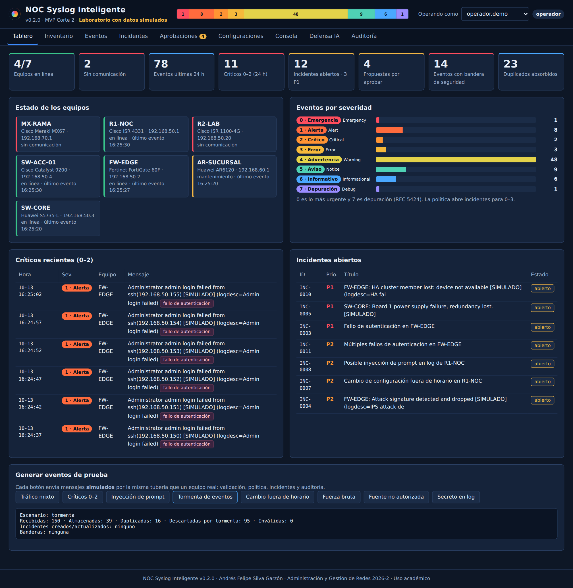

# NOC Syslog Inteligente · v0.2.0 (MVP, Corte 2)

Aplicación web para un Centro de Operaciones de Red (NOC) que **recibe e importa eventos Syslog de Cisco, Fortinet y Huawei**, los normaliza por severidad (0–7), muestra el estado de la red, gestiona incidentes con trazabilidad y aplica una **política explícita de defensa frente a acciones no autorizadas de agentes de IA**.

> **Laboratorio con datos simulados.** Todos los equipos, direcciones IP y eventos incluidos son ficticios y están rotulados como `simulado`. La aplicación no se conecta a ningún equipo real.

| | |
|---|---|
| Autor | Andrés Felipe Silva Garzón |
| Asignatura | Administración y Gestión de Redes · Periodo 2026-2 |
| Docente | Ing. John Harold Pérez Calderón |
| Versión | v0.2.0 (MVP) · v0.1.0 = versión alfa |
| Licencia | Uso académico (ver `LICENSE`) |



## Problema que resuelve

Los eventos de una red multivendor quedan dispersos en cada equipo, con formatos y horas distintas. El operador se entera tarde de caídas, accesos fallidos o cambios, y no hay control sobre lo que una herramienta automatizada pueda ejecutar. Este NOC centraliza los eventos, abre incidentes según una política y obliga a que cualquier acción pase por aprobación humana y quede auditada.

## Funciones

- **Inventario** editable (nombre, IP, marca, modelo, versión, ubicación, estado, fecha de actualización); sirve de lista de fuentes autorizadas.
- **Recepción Syslog** por UDP de laboratorio y **importación** de archivos `.log`/`.txt`.
- **Normalización** de RFC 3164, RFC 5424, Cisco IOS/IOS XE, FortiOS y Huawei VRP: fecha, equipo, fabricante, facility y severidad 0–7.
- **Tablero** con estado de equipos, eventos por severidad, críticos recientes e incidentes; **filtros** por fecha, marca, equipo, severidad, bandera y texto; exportación CSV.
- **Incidentes** automáticos o manuales con prioridad P1–P4, SLA, asignación, seguimiento y cierre con causa y resolución.
- **Aprobaciones**: propuesta → revisión humana → aprobación → ejecución (simulada) → verificación → auditoría.
- **Generador** de configuraciones Syslog comentadas para Cisco, Fortinet y Huawei, con verificación y rollback.
- **Consola tipo PuTTY simulada**, solo lectura, con allowlist por fabricante y bloqueo auditado.
- **Defensa ante IA**: detección de inyección de prompt en logs, cuarentena de fuentes no inventariadas, enmascarado de secretos, control de tormentas, deduplicación, cambios fuera de horario, fuerza bruta, RBAC y auditoría encadenada SHA-256.

## Arquitectura

```
Equipos (simulados) ──UDP 5514──► Receptor ─┐
Archivo .log / simulador ───────────────────┼─► Ingesta: validación → protección → control de tormenta
                                            │      → deduplicación → política → incidente/propuesta
                                            └─► SQLite ◄── API REST (Flask) ◄── Dashboard HTML/CSS/JS
```

Detalle y diagramas: [`docs/arquitectura.md`](docs/arquitectura.md) · Modelo de datos: [`docs/modelo_datos.md`](docs/modelo_datos.md)

## Requisitos previos

- Python **3.10 o superior** (`python --version`)
- Git
- Navegador moderno (Chrome, Edge o Firefox)

## Instalación desde cero

**Windows (PowerShell)**

```powershell
git clone https://github.com/TU-USUARIO/noc-syslog-inteligente.git
cd noc-syslog-inteligente
python -m venv .venv
.\.venv\Scripts\Activate.ps1          # si lo bloquea: Set-ExecutionPolicy -Scope CurrentUser RemoteSigned
pip install -r requirements.txt
copy .env.example .env               # opcional: ajuste valores locales
```

**Linux / macOS**

```bash
git clone https://github.com/TU-USUARIO/noc-syslog-inteligente.git
cd noc-syslog-inteligente
python3 -m venv .venv && source .venv/bin/activate
pip install -r requirements.txt
cp .env.example .env
```

## Configuración

Todas las opciones se leen de variables de entorno (archivo `.env`, que **no** se sube a GitHub). Ver [`.env.example`](.env.example): umbral de incidentes, límite de eventos por minuto, ventana de deduplicación, horario laboral, puerto UDP. Sin `.env` la aplicación usa valores seguros por defecto.

## Ejecución

```bash
python run.py              # tablero en http://127.0.0.1:5000
python run.py --udp        # además escucha Syslog UDP en 127.0.0.1:5514
python run.py --reset      # reinicia la base local con el inventario simulado
```

Recorrido sugerido para la demostración:

1. **Tablero → Generar eventos de prueba**: "Tráfico mixto", luego "Críticos 0–2".
2. **Eventos → Importar archivo**: `data/samples/syslog_simulado_lab.log`. Filtrar por marca *Cisco* y "Hasta severidad 3 · Error".
3. **Incidentes**: abrir uno, asignarlo, pasarlo a *en progreso → resuelto → cerrado* con causa y resolución.
4. **Aprobaciones**: como `admin.demo` aprobar la propuesta del agente; como `operador.demo` ejecutarla y verificarla.
5. **Configuraciones**: "Las tres marcas" con IP del colector y umbral.
6. **Consola**: `show version` (permitido) y `configure terminal` (bloqueado).
7. **Defensa IA**: escenario "Inyección de prompt" y revisar el evento marcado.
8. **Auditoría**: verificar la cadena y exportar la evidencia JSON.

### Probar el receptor UDP

```bash
python run.py --udp
# en otra terminal:
python scripts/send_test_syslog.py --count 10
```

Los datagramas llegan desde `127.0.0.1`. Si ese origen no está en el inventario, la política los deja como **fuente no autorizada** (prueba de la allowlist). Para aceptarlos, registre en *Inventario* un equipo `LAB-LOCAL` con IP `127.0.0.1`.

## Pruebas

```bash
python -m pytest -v
```

35 pruebas automatizadas: parser, inventario, filtros (HU-02), ciclo de incidentes (HU-03), plantillas (HU-04), consola y auditoría (HU-05), inyección de prompt, secretos, fuentes no autorizadas, tormentas, fuerza bruta, flujo de aprobación y alteración de la auditoría. Detalle en [`docs/pruebas.md`](docs/pruebas.md).

## Seguridad

- Secretos solo en `.env` (excluido por `.gitignore`); `.env.example` no contiene valores reales.
- Los logs se tratan como **datos no confiables**: se sanean, se enmascaran secretos, se escapan en la interfaz y nunca se usan como instrucción.
- Consultas SQL parametrizadas; cabeceras CSP, `X-Frame-Options` y `nosniff`; depurador de Flask desactivado; servidor ligado a `127.0.0.1`.
- Roles: `lector`, `operador`, `administrador`, `agente` (solo propone). Quien propone no aprueba.
- Política completa: [`docs/politica_defensa_ia.md`](docs/politica_defensa_ia.md) · [`docs/politica_syslog.md`](docs/politica_syslog.md)

## Limitaciones conocidas (v0.2.0)

- La ejecución de acciones aprobadas es **simulada**; no hay SSH real.
- Identidad simulada (selector de usuario); el rol lo decide el servidor, pero no hay contraseña ni MFA.
- Syslog por UDP sin cifrado (laboratorio). Sin alertas Telegram.
- Servidor de desarrollo de Flask: no apto para producción.

## Estructura

```
noc-syslog-inteligente/
├── run.py                  # punto de entrada
├── requirements.txt  .env.example  .gitignore  LICENSE  CHANGELOG.md
├── app/
│   ├── __init__.py         # fábrica Flask, cabeceras de seguridad
│   ├── config.py  db.py  schema.sql
│   ├── collector/          # parser, ingesta, receptor UDP, simulador
│   ├── incidents/          # prioridad, SLA, transiciones
│   ├── security/           # política IA, RBAC, auditoría encadenada
│   ├── configgen/          # plantillas Cisco / Fortinet / Huawei
│   ├── console/            # consola simulada
│   ├── api/                # endpoints REST
│   └── web/                # HTML, CSS, JS
├── data/samples/           # logs SIMULADOS de prueba
├── docs/                   # alcance, requisitos, historias, arquitectura, políticas, pruebas, evidencias
├── scripts/                # utilidades (envío UDP de prueba)
└── tests/                  # pytest
```

## Versiones

| Etiqueta | Contenido |
|---|---|
| `v0.1.0` | Alfa: estructura, modelo de datos, inventario, colector e incidentes por API |
| `v0.2.0` | MVP Corte 2: tablero, aprobaciones, plantillas, consola, política IA, pruebas y documentación |

Para volver a una versión estable: `git checkout v0.2.0` (y `python run.py --reset` si cambió el esquema).
