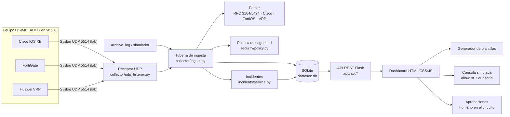
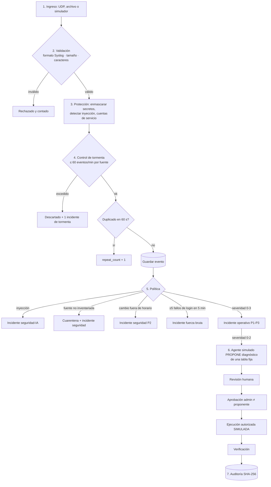

# Arquitectura y flujo - NOC Syslog Inteligente v0.2.0

Las imágenes están en [`docs/diagramas/`](diagramas/). Los diagramas en Mermaid se ven directamente en GitHub.

## Arquitectura de referencia

## Flujo lógico de un evento

## Módulos

| Carpeta | Responsabilidad |
|---|---|
| `app/collector/` | Parser, tubería de ingesta, receptor UDP y simulador de escenarios |
| `app/incidents/` | Reglas de prioridad, SLA, transiciones y bitácora |
| `app/security/` | Política de defensa ante IA, RBAC, allowlists, auditoría encadenada |
| `app/configgen/` | Plantillas Cisco / Fortinet / Huawei con verificación y rollback |
| `app/console/` | Consola tipo PuTTY simulada, de solo lectura |
| `app/api/` | Endpoints REST (blueprints de Flask) |
| `app/web/` | Interfaz de una sola página (HTML, CSS, JavaScript sin frameworks) |
| `tests/` | 35 pruebas automatizadas con pytest |

## Decisiones de diseño

| Decisión | Valor | Justificación | Riesgo | Validación |
|---|---|---|---|---|
| Lenguaje y framework | Python 3 + Flask | Curva de aprendizaje baja, biblioteca estándar suficiente | Servidor de desarrollo no apto para producción | Corte 3: Waitress/Gunicorn detrás de proxy |
| Base de datos | SQLite (WAL) | Un solo archivo, sin instalación, respaldo por copia | Concurrencia limitada | Prueba de tormenta de 150 eventos |
| Puerto Syslog | UDP 5514 en 127.0.0.1 | 514 requiere privilegios; laboratorio aislado | Sin cifrado ni confirmación de entrega | Documentado; TLS en Corte 3 |
| Identidad | Usuario elegido en la interfaz, rol calculado en el servidor | Demuestra RBAC sin gestionar contraseñas | No es autenticación real | Pruebas 403 por rol |
| Agente de IA | Simulado y basado en reglas, solo propone | Demuestra el flujo seguro sin depender de un modelo externo | No representa un LLM real | `test_inyeccion_de_prompt_no_altera_la_politica` |
