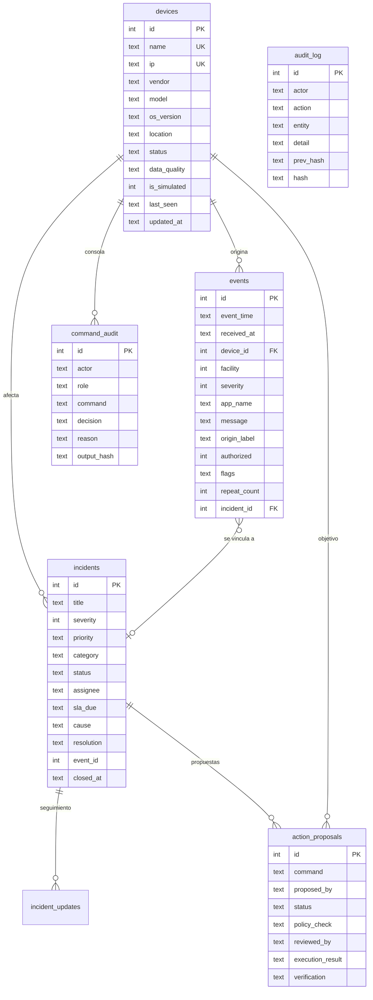

# Modelo de datos (SQLite) - v0.2.0

Definición completa y comentada en [`app/schema.sql`](../app/schema.sql).

| Tabla | Propósito |
|---|---|
| `devices` | Inventario y lista de fuentes autorizadas. `data_quality` separa dato confirmado de dato por verificar; `is_simulated` rotula el laboratorio. |
| `events` | Eventos normalizados. `flags` guarda las banderas de seguridad; `signature` y `repeat_count` implementan la deduplicación. |
| `incidents` | Incidentes con prioridad P1–P4, SLA, responsable, causa y resolución. `signature` evita incidentes duplicados. |
| `incident_updates` | Bitácora de seguimiento de cada incidente. |
| `action_proposals` | Flujo propuesta → revisión → aprobación → ejecución → verificación. |
| `command_audit` | Cada comando escrito en la consola, permitido o bloqueado, con hash SHA-256 de la salida. |
| `audit_log` | Auditoría general encadenada (cada fila guarda el hash de la anterior). |
